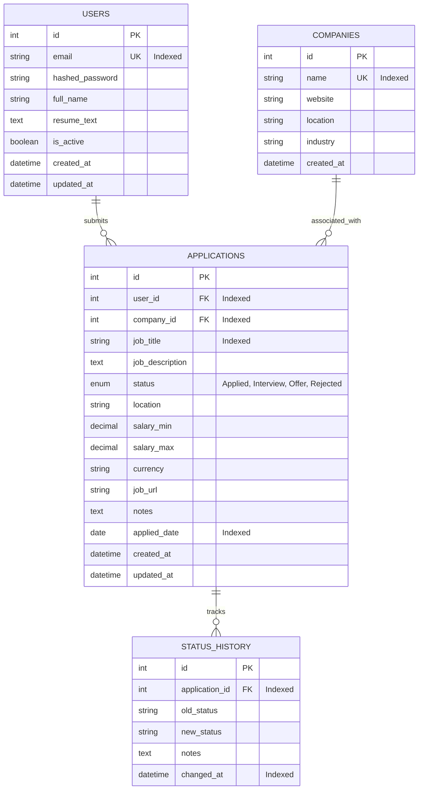

# Project: Job Application Tracker API (FastAPI + PostgreSQL)

[](https://github.com/preethi-prabhakaran/job-application-tracker-api/actions)
[](https://fastapi.tiangolo.com)
[](https://www.python.org/)
[](https://www.postgresql.org/)
[](https://www.docker.com/)
[](https://render.com/)

A production-grade RESTful API engineered with **FastAPI**, **PostgreSQL**, and **SQLAlchemy 2.0** for tracking job applications, managing prospective companies, auditing application lifecycle status changes, computing real-time SQL response analytics, and scoring resume-to-job-description alignment using an NLP heuristic matching engine.

This project seamlessly complements the **AI Smart Resume Builder**, extending the candidate workflow from resume composition to application pipeline management and automated keyword gap analysis.

---

## 📌 Missing JD Keywords Covered
- **FastAPI**: Modern, high-performance web framework with asynchronous support, dependency injection, and automatic OpenAPI / Swagger documentation.
- **Python**: Clean, modular Python 3.12 implementation adhering to PEP 8 standards and strict type annotations.
- **SQL & PostgreSQL**: Normalized relational schema, foreign key constraints, indexes, and complex aggregation queries (`GROUP BY`, `CASE`, window/date functions).
- **REST APIs**: Full CRUD architecture with standard HTTP status codes, structured error payloads, filtering, sorting, and pagination.
- **Git & GitHub Actions**: Automated CI/CD pipeline executing test suites against a containerized PostgreSQL service on push and PR.
- **Docker & Docker Compose**: Multi-stage containerization for seamless local setup and cloud deployment.

---

## 🏗️ Architecture & Relational Schema



---

## 🚀 Core Features

### 1. Authentication & Security
- **Bcrypt Password Hashing**: Passwords salt-hashed with bcrypt (work factor 12) before database persistence.
- **OAuth2 Bearer JWT**: Stateless JSON Web Token authentication with configurable expiration (7 days default) and secret key validation.
- **Account Isolation**: Robust row-level multi-tenancy ensures users only access and modify their own applications and analytics.

### 2. Comprehensive CRUD & Application Management
- **Companies Management**: Manage hiring organizations with automatic duplicate resolution and search.
- **Job Applications CRUD**: Track job title, company, salary ranges, location, JD, custom notes, and application dates.
- **Filtering & Pagination**:
  - Filter by status (`Applied`, `Interview`, `Offer`, `Rejected`).
  - Search by keyword in job title, company name, or location.
  - Filter by date range (`date_from`, `date_to`).
  - Configurable pagination (`page`, `page_size`, total count, total pages).
- **Automated Status Audit Log (`status_history`)**:
  - Automatically records an audit row whenever an application is submitted or its status changes.
  - Timeline endpoint (`GET /api/v1/applications/{id}/history`) tracks status progression dates and notes.

### 3. SQL Aggregation Analytics
- **Status Distribution**: Real-time `GROUP BY status` counts and percentages.
- **Candidate Funnel Metrics**: Calculates overall response rate, interview conversion rate, and offer conversion rate.
- **Weekly Submission Velocity & Response Trends**: Grouped by application cohort week to display submission volume and response conversion over time.

### 4. AI Resume-to-JD Matcher (`POST /applications/{id}/match`)
- Ported and enhanced from the **AI Smart Resume Builder** heuristic NLP engine.
- Extracts categorized technical skills (Languages, Frameworks, Databases, Cloud & DevOps, Architecture, Testing, AI/ML, Developer Tools).
- Compares resume text against the target job description.
- Computes:
  - **Match Score (0-100)** with qualitative tier rating.
  - **Matching Keywords** present in both candidate resume and JD.
  - **Missing Critical Keywords** that the applicant should incorporate.
  - **Category-specific competency breakdowns**.
  - **Actionable ATS recommendations** using the Google XYZ formula (*"Accomplished [X] as measured by [Y] by doing [Z]"*) and strong action verbs.

---

## 📡 API Endpoints Overview

| Method | Endpoint | Description | Auth Required |
|---|---|---|:---:|
| `GET` | `/` | Service health and documentation links | ❌ |
| `GET` | `/health` | Deep health check (DB connectivity & environment) | ❌ |
| `POST` | `/api/v1/auth/register` | Register new user with bcrypt-hashed password | ❌ |
| `POST` | `/api/v1/auth/login` | Authenticate via OAuth2 form data (returns JWT) | ❌ |
| `POST` | `/api/v1/auth/login/json` | Authenticate via JSON payload (returns JWT) | ❌ |
| `GET` | `/api/v1/auth/me` | Fetch authenticated user profile & resume | ✅ |
| `PUT` | `/api/v1/auth/me` | Update profile information or stored resume | ✅ |
| `GET` | `/api/v1/companies` | List companies with search and pagination | ✅ |
| `POST` | `/api/v1/companies` | Register a new target company | ✅ |
| `GET` | `/api/v1/companies/{id}` | Get company profile by ID | ✅ |
| `PUT` | `/api/v1/companies/{id}` | Update company details | ✅ |
| `DELETE` | `/api/v1/companies/{id}` | Remove company | ✅ |
| `GET` | `/api/v1/applications` | List applications (with filtering & pagination) | ✅ |
| `POST` | `/api/v1/applications` | Create job application (creates initial status log) | ✅ |
| `GET` | `/api/v1/applications/{id}` | Retrieve application details & history | ✅ |
| `PUT` | `/api/v1/applications/{id}` | Update application fields & status (logs transition) | ✅ |
| `DELETE` | `/api/v1/applications/{id}` | Delete job application and cascaded history | ✅ |
| `GET` | `/api/v1/applications/{id}/history` | Fetch status transition timeline | ✅ |
| `GET` | `/api/v1/analytics` | SQL aggregation for status counts & weekly response rate | ✅ |
| `POST` | `/api/v1/applications/{id}/match` | Score resume against JD and extract missing keywords | ✅ |

Interactive documentation is automatically generated and accessible at:
- Swagger UI: `http://localhost:8000/docs`
- ReDoc: `http://localhost:8000/redoc`

---

## 🛠️ Local Development & Quickstart

### Option A: Running with Virtual Environment (Zero-Config SQLite / PostgreSQL)

1. **Clone the repository**:
   ```bash
   git clone https://github.com/preethi-prabhakaran/job-application-tracker-api.git
   cd job-application-tracker-api
   ```

2. **Create and activate a virtual environment**:
   ```bash
   # Windows
   python -m venv .venv
   .\.venv\Scripts\activate

   # macOS / Linux
   python3 -m venv .venv
   source .venv/bin/activate
   ```

3. **Install dependencies**:
   ```bash
   pip install -r requirements.txt
   ```

4. **Run Alembic database migrations**:
   ```bash
   alembic upgrade head
   ```

5. **Start the FastAPI server**:
   ```bash
   uvicorn app.main:app --reload --host 0.0.0.0 --port 8000
   ```
   Open `http://localhost:8000/docs` in your browser.

---

### Option B: Running with Docker & Docker Compose

Run the entire stack with PostgreSQL and FastAPI in isolated containers:

```bash
docker-compose up --build
```

The API will be available at `http://localhost:8000`, connected to a live PostgreSQL 16 container with automatic migrations executed on startup.

---

## 🧪 Testing with Pytest

The project includes an automated test suite covering authentication, authorization, CRUD operations, multi-tenancy isolation, SQL aggregation analytics, and AI matching:

```bash
pytest -v
```

All 29 tests run against an isolated in-memory test database with rolled-back transactions per test.

---

## 🚀 Deployment on Render

This project is configured for one-click deployment via **Render Blueprints** (`render.yaml`):

1. Push this repository to GitHub.
2. Log into [Render](https://render.com) and navigate to **Blueprints**.
3. Select **New Blueprint Instance** and connect your GitHub repository.
4. Render will automatically provision:
   - **PostgreSQL Database**: Free managed PostgreSQL instance (`job-tracker-postgres`).
   - **Web Service**: Python environment running FastAPI (`job-tracker-api`), with `alembic upgrade head` automated in the build pipeline.
5. Your live API will be instantly reachable at `https://<your-service>.onrender.com/docs`.

---

## 📄 Resume Entry

Add this bulleted section to your resume to showcase full-stack backend and AI competencies:

```markdown
Job Application Tracker API | Python, FastAPI, PostgreSQL, SQLAlchemy, Alembic, Docker, GitHub Actions | GitHub
• Built a REST API with FastAPI and PostgreSQL featuring JWT authentication, full CRUD, filtering and pagination for job applications.
• Designed a relational schema with SQLAlchemy and Alembic migrations, and SQL aggregation queries for application status analytics.
• Added an AI endpoint that scores resume-to-job-description match and lists missing keywords.
• Wrote pytest tests, containerised the app with Docker, and set up GitHub Actions CI with deployment on Render.
```

---

## 📜 License
MIT License. Created by Preethi Prabhakaran.
